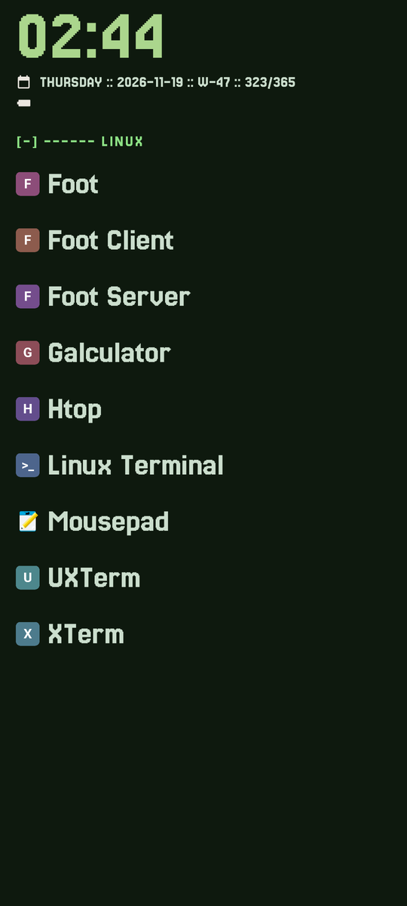
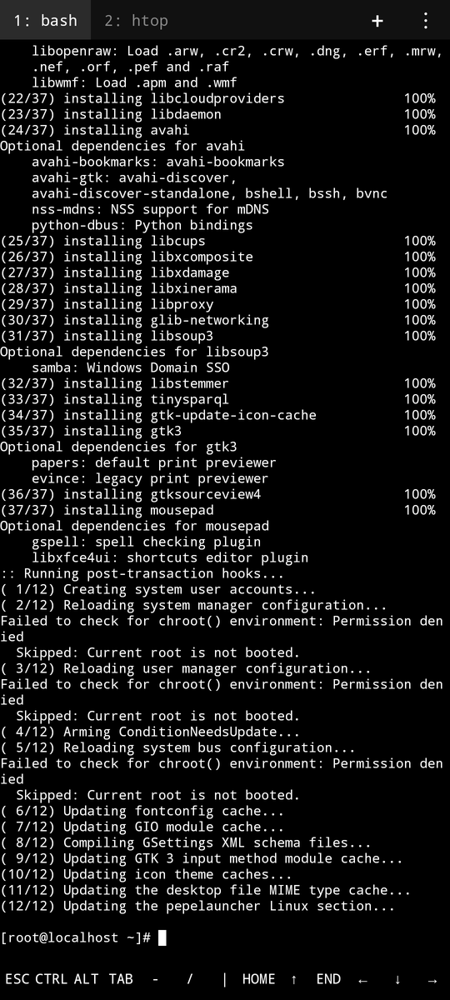
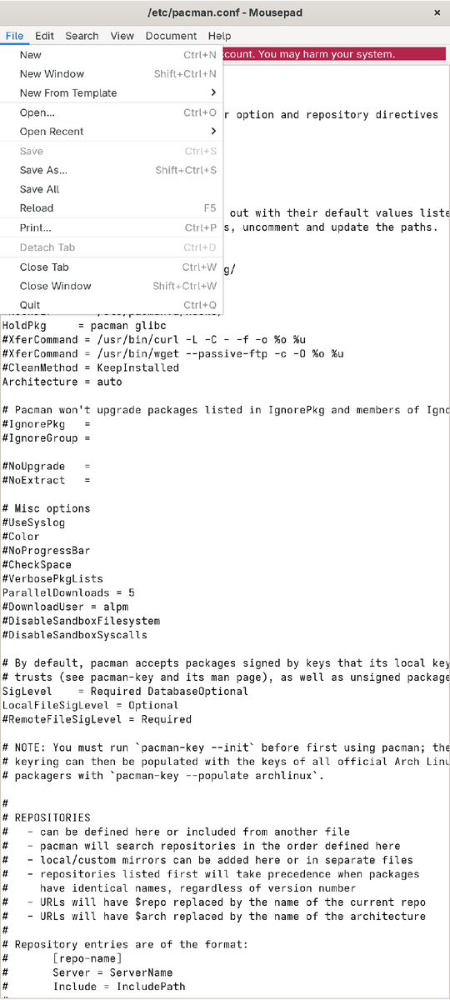
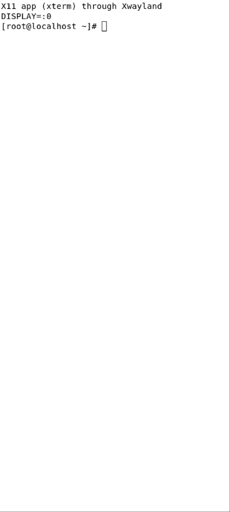
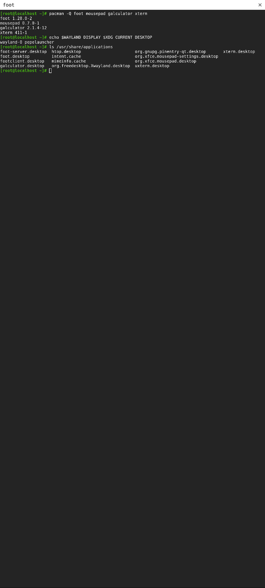
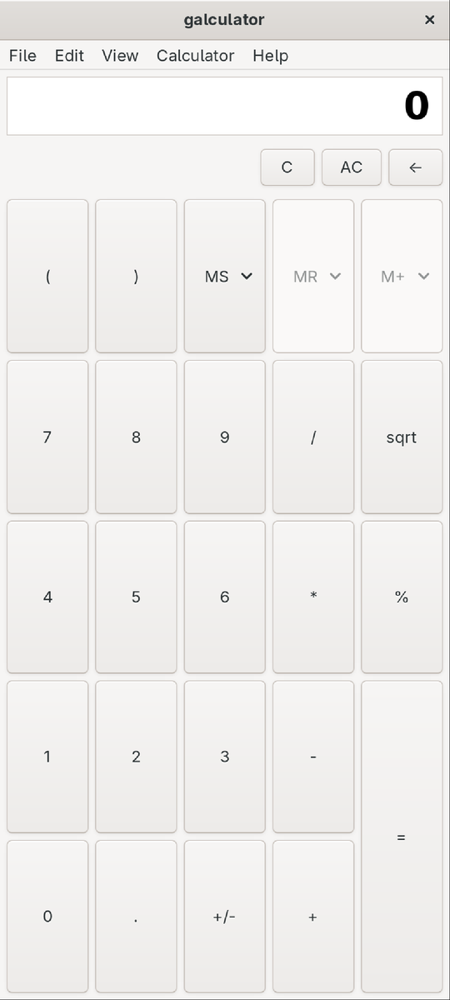
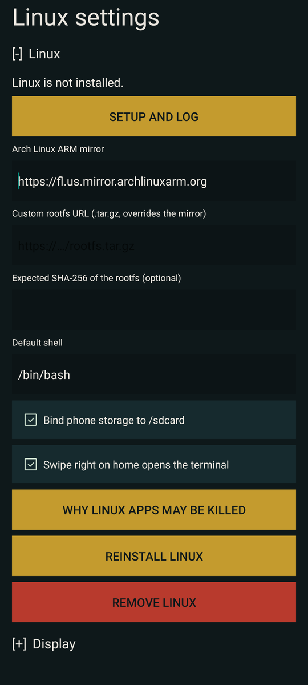
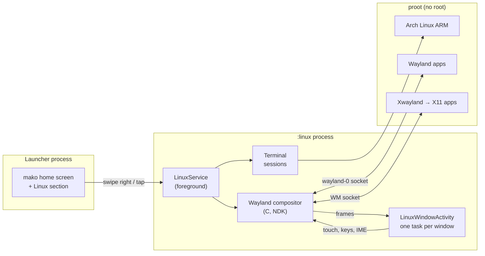

# pepelauncher

**A minimal Android launcher with a complete Arch Linux system inside, without root.**
Every Linux window opens as its own Android app, with its own card in Recents.

pepelauncher is a fork of the privacy-first launcher [mako](https://github.com/rama-io/mako).
The home screen stays mako's fast, text-first app list. Swipe right and you are in a real Linux
terminal. Install a Linux program with `pacman` and it appears next to your Android apps.
Tap it and it opens in its own window, which Android treats like any other app.

<p>
  
  
  
  
</p>

> **Project status: early and not yet tested on a phone.** Everything builds and is covered by
> automated tests, and the Linux side has been run end to end on a desktop, using the same proot
> sources and the same compositor code (see [How it was tested](#how-it-was-tested)). The first
> on-device runs still have to happen. Expect rough edges, and please report what you find.

---

## Features

### A launcher first

- Everything mako offers: a fast, distraction-free app list with groups, favourites, fuzzy
  search, custom names, icon packs, themes, the clock/date/battery header, a PIN-locked settings
  screen and private space support.
- Works as a normal Android home screen. Your Android apps stay exactly where they were.

### Arch Linux ARM, without root

- On first use, pepelauncher downloads the official **Arch Linux ARM** root filesystem from a
  mirror you can choose, checks it against the published checksum (optionally a SHA-256 you
  provide), unpacks it and updates it with `pacman -Syu`. Interrupted downloads resume; a failed
  setup can simply be retried.
- Runs in **proot**: no root, no Termux, no Shizuku, no extra apps. proot is built from source
  and shipped inside the app, as Android 10+ requires.
- Your phone's storage can be mounted at `/sdcard` inside Linux (optional, needs "All files
  access").
- pacman, the keyring, locales, DNS and hosts are configured automatically. The kernel and firmware
  packages, which are useless in proot, are removed.

### Swipe right for a terminal


- A full-screen terminal running `bash -l` (or your shell) as root inside Arch.
- Several sessions in tabs, an extra-keys row (Esc, Ctrl, Alt, Tab, arrows, Home/End, `- / |`),
  pinch to zoom, copy and paste, an URL picker, 256 colours and true colour.
- Sessions keep running when you leave: a foreground service owns them. Swipe left (or press
  Back) to return home.
- Built on the Termux terminal emulator libraries.

<br clear="right">

### Linux apps in your app list


- A **Linux** section in the app list, built with mako's own list and groups.
- `pacman -S mousepad` adds Mousepad to the list, and `pacman -Rns mousepad` removes it. A pacman
  hook tells the launcher, so there is nothing to refresh.
- Names (localised), icons (hicolor and Adwaita themes, PNG or SVG), `Terminal=true` apps
  (opened in the terminal) and the `NoDisplay`, `Hidden`, `OnlyShowIn` and `TryExec` rules are
  honoured.
- Long-press for **Add to Favorites**, **Add to home screen** (pinned shortcut), **Package info**
  (`pacman -Qi`) and **Uninstall** (`pacman -Rns`, shown in the terminal).
- A built-in **Linux Terminal** entry is there from the start.

<br clear="right">

### Every Linux window is an Android task

<p>
  
  
  
  
  
</p>

- pepelauncher contains its own **Wayland compositor**. Each window an app opens gets its own
  Android Activity and task: its own Recents card, title and icon (taken from the app's `.desktop`
  file). Two Mousepad windows give two cards.
- **X11 apps** work through Xwayland, with a small built-in X window manager.
  The Linux settings screen offers a button that installs Xwayland.
- Split screen, freeform windows and picture-in-picture resize the Linux window to match.
- Menus and popups stay inside their window. Dialogs open in their own task, or, if you prefer,
  attached to their parent window.
- **Input:** touch acts as a mouse (tap to click, long-press to right-click, two fingers to
  scroll), or as real touch input. A mouse, a hardware keyboard and the on-screen keyboard all
  work. Apps that support it get proper input-method text (text-input-v3).
- **Clipboard** is shared both ways between Linux apps and Android.
- Closing a window ends its task. Swiping a card away asks the app to close, and stops it if it
  does not respond.
- Apps that are wider than a phone screen (desktop minimum sizes) are scaled to fit instead of
  being cut off. Fractional scaling uses your screen's density.

### Settings



Found under **Settings › Linux settings** (long-press empty space on the home screen):

- **Linux:** mirror, custom rootfs URL, expected SHA-256, default shell, `/sdcard` binding,
  swipe-right toggle, reinstall or remove Linux, storage used.
- **Display:** scale factor, touch as mouse or touch, show the keyboard automatically.
- **Recents:** dialogs in their own task or attached to the parent.
- **Backup:** export the whole Linux system as `.tar.zst`, and import it again.

<br clear="right">

---

## Requirements

- Android **10 to 15**. No root.
- A 64-bit ARM phone (arm64-v8a). 32-bit ARM (armeabi-v7a) is built too, and uses the
  armv7 Arch Linux ARM image.
- About **3 GB** of free storage for setup (the rootfs is ~2 GB unpacked, plus what you install).
- A network connection for setup and for installing packages.

## Getting started

1. Build and install the APK (see [Building](#building)). There are no published releases yet.
2. Open pepelauncher and make it your home app (Settings › System › *Set as default*).
3. **Swipe right** on the home screen. The first time, this opens setup. Tap **Install Linux** and
   wait. Setup keeps running in the background with a notification.
4. When it is done, swipe right again for the terminal, and install apps, for example:
   ```sh
   pacman -S foot mousepad xorg-xwayland
   ```
5. The apps appear in the **Linux** section of your app list. Tap one to open it.

### Android 12 and newer: the "phantom process" limit

Android 12+ kills apps that run many background processes, and Linux programs count. If
sessions die with "signal 9":

- **Android 14+:** Settings › System › Developer options › turn on **Disable child process
  restrictions**.
- **Android 12/13**, from a computer with `adb`:
  ```sh
  adb shell "/system/bin/device_config set_sync_disabled_for_tests persistent; /system/bin/device_config put activity_manager max_phantom_processes 2147483647"
  ```

pepelauncher shows the same guidance in the setup screen, the terminal menu and the settings.

---

## Two builds

| Build | What it is | Permissions |
|---|---|---|
| **`linux`** (default) | pepelauncher as described here | Internet (downloads only), foreground service, notifications, optional storage access |
| **`plain`** | Exactly mako, renamed: no Linux, no native code | Same as mako: **no network access** |

Both come from one source tree. The `BuildConfig.LINUX_ENABLED` flag is set by the build flavor.

### Privacy

pepelauncher has no analytics, no telemetry and no accounts. The `linux` build only connects to
the network to download the Arch Linux ARM image from the mirror you choose. Anything else is
what you yourself run inside Linux, such as `pacman`. The `plain` build cannot use the network
at all, just like mako.

---

## How it works



- **proot** (the Termux fork) and its loader are shipped as `libproot.so` and
  `libproot-loader.so`. Android only lets apps run programs from their native-library directory,
  so that is where they live.
- **Setup** downloads the image (resumable, checksum-verified), unpacks it without root, and
  configures it. Every step leaves a marker, so setup can be retried at any point.
- **The compositor** is a small C program built with the NDK. It uses libwayland-server and
  xkbcommon, with a minimal X window manager on libxcb for Xwayland. Each toplevel is drawn into
  its own Activity's `SurfaceView`. It runs in a separate `:linux` process, so the launcher and the
  Linux side cannot take each other down.
- **The Linux section** reads `.desktop` files directly from the rootfs. A pacman hook updates a
  stamp file that the launcher watches.

More detail: [docs/PLAN.md](docs/PLAN.md) (design), [docs/SOURCE_NOTES.md](docs/SOURCE_NOTES.md)
(how mako is built) and [compositor/README.pepelauncher.md](compositor/README.pepelauncher.md).

---

## Building

```sh
git clone --recurse-submodules https://github.com/xmrpepe/Pepelauncher
cd Pepelauncher
sh gradlew assembleLinuxDebug     # pepelauncher → app/build/outputs/apk/linux/debug/
sh gradlew assemblePlainDebug     # mako-equivalent build
sh gradlew test                   # unit tests
```

You need JDK 17+, the Android SDK (platform 37, build-tools 37.0.0), **NDK r28c**
(`28.2.13676358`) and GNU `make`. proot is compiled from source as part of the build. Full
instructions, including how to rebuild proot and how to run the desktop tests, are in
[docs/BUILDING.md](docs/BUILDING.md).

## How it was tested

| What | How |
|---|---|
| Unit tests (268) | `.desktop` parsing, proot command building, extraction, resumable download, pacman configuration, key mapping, URL detection, plus mako's and Termux's own tests |
| Linux setup end to end | A desktop build of the same proot sources runs the real setup code against an Arch Linux image, including `pacman -Syu` (`HostSetupIntegrationTest`) |
| Linux section | `pacman -S mousepad` adds the entry with its icon; `pacman -Rns` removes it (`HostAppsIntegrationTest`) |
| Compositor | `compositor/host/smoke-test.sh` runs the real compositor core with real apps: foot gets a window, two Mousepads get two windows, xeyes works through Xwayland, closing a window removes it |
| On a phone | **Not yet.** The instrumented `SetupSmokeTest` (proot runs from the app's native-library directory) is ready to run on a device |

**About the screenshots:** the home, terminal, setup and settings screens were rendered with the
real Android framework through Robolectric. The terminal replays real `pacman` output recorded
from a test system. The Linux windows are the compositor's own output, captured from its desktop
test backend at phone resolution (1080×2400, 420 dpi), with apps from an Arch Linux test system.
They are not photos of a phone. Some icons show letter tiles, because the test render cannot
convert SVG icons; on a phone, `rsvg-convert` does that inside Linux.

## Known limitations

- Drawing is done on the CPU. GPU acceleration (linux-dmabuf) is a planned later stage.
- The clipboard is shared with Wayland apps only, not yet with X11 apps.
- Typing characters that are not on a US keyboard layout works only in apps that support
  text-input-v3 (GTK, foot, …). X11 apps get US-layout characters only.
- There is no package search screen yet: use `pacman -Ss` in the terminal.
- Opening a Linux window while pepelauncher is in the background shows a notification
  instead of the window, because Android does not allow apps to start activities from the
  background.

---

## Credits and license

pepelauncher is based on **[mako](https://github.com/rama-io/mako)** by
[Pombo](https://github.com/pomboverso) and contributors, and on its UI library
[bohio](https://github.com/rama-io/bohio). Thank you! pepelauncher is not affiliated with mako;
please report pepelauncher problems here, not upstream.

It also builds on [PRoot](https://github.com/termux/proot) (Termux fork), talloc, the Termux
terminal libraries, Apache Commons Compress, libwayland, libffi, libxkbcommon, libxcb and Arch
Linux ARM. See [NOTICE](NOTICE) for the full list and licenses.

pepelauncher is free software under the **GNU General Public License v3.0 or later**, like mako.
See [LICENSE](LICENSE). Every change made to mako's own files is listed in
[docs/UPSTREAM_PATCHES.md](docs/UPSTREAM_PATCHES.md).
